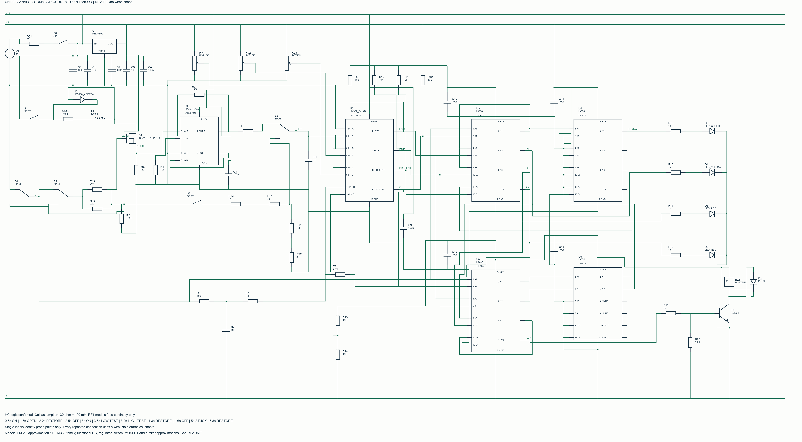
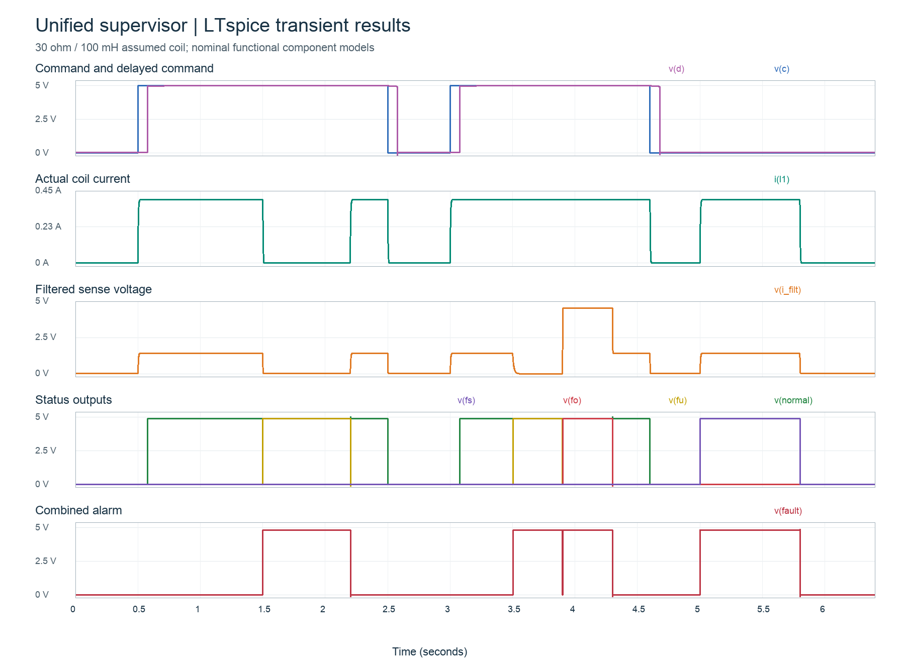
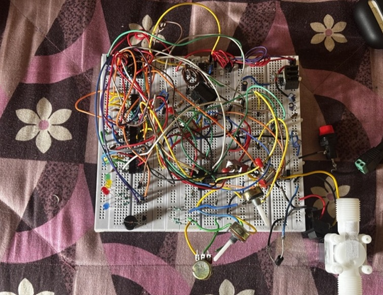
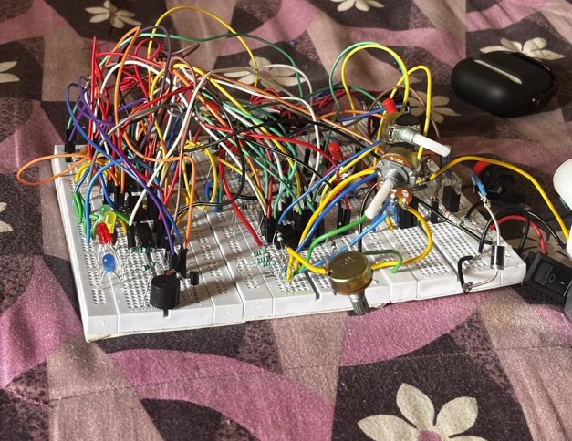

# Low Complexity Analog Command Current Consistency Supervisor for Electromagnetic Actuators

A discrete analog and digital-logic supervisor for a **12 V electromagnetic actuator (solenoid)** that checks whether the actual coil current matches the commanded `ON`/`OFF` state, with no microcontroller, ADC or firmware.

Course project, Analog Electronics (BAECE203), School of Electronics Engineering (SENSE), VIT.

---

## Key Features

* **Current sensing:** a `0.22 Ω` low-side shunt and non-inverting `LM358` stage (gain `16`) followed by a `1 kΩ + 1 µF` filter (`fc ≈ 159 Hz`) give `Vsense ≈ 3.52 × Icoil`.
* **Three current thresholds:** three `LM339` comparators flag `LOW` (`0.85 V`), `HIGH` (`2.11 V`) and `PRESENT` (`0.21 V`); the fourth squares up the command delay.
* **Fault logic:** `74HC08` (AND), `74HC32` (OR) and `74HC04` (NOT) gates drive four status LEDs and a `2N3904`-switched `5 V` active buzzer.
* **Switching-transient immunity:** a `100 kΩ + 1 µF` delay (`≈ 79 ms` simulated) qualifies `ON` and `OFF` decisions (`Q = C · D`, `OFF_ARM = ¬(C + D)`) so the coil's current rise and fall do not cause false alarms.
* **Low-power commissioning:** an `SPDT` sense selector (`S2`) and `SPST` high-test switch (`S3`) feed resistor-divided test voltages (`~0 V` for undercurrent, `4.53 V` for overcurrent) to the comparators using `1/4 W` resistors, while the coil keeps running normally.

---

## Operating States & Fault Logic

| Condition | Command (`C`) | Coil Current (`0.40 A` nominal) | Active LED | Buzzer |
| :--- | :---: | :---: | :---: | :---: |
| **Idle OFF** | `OFF` | `0 A` (`< 0.06 A`) | All OFF | OFF |
| **Normal ON** | `ON` | `~0.40 A` (`0.24 A – 0.60 A`) | **Green (`NORMAL`)** | OFF |
| **Undercurrent / Open Load** | `ON` | `< 0.24 A` (`Vref = 0.85 V`) | **Yellow (`FU`)** | **ON** |
| **Overcurrent** | `ON` | `> 0.60 A` (`Vref = 2.11 V`) | **Red (`FO`)** | **ON** |
| **Uncommanded / Stuck Driver** | `OFF` | `> 0.06 A` (`Vref = 0.21 V`) | **Red (`FS`)** | **ON** |

```
Q        = C AND D              FU = Q AND LOW
OFF_ARM  = NOT (C OR D)         FO = Q AND HIGH
NORMAL   = Q AND NOT (LOW OR HIGH)
FS       = OFF_ARM AND PRESENT  FAULT = FU OR FO OR FS
```

---

## Circuit Schematic & Simulation Results

### Full LTspice Schematic


### 6.4 s Transient Validation (`simulation/Unified_Supervisor.asc`)
1. `0.5 s` — Normal `ON` (`0.40 A` coil current, `1.43 V` filtered sense, green LED on)
2. `1.5 s – 2.2 s` — Open coil (`0 A`, yellow `FU` LED + buzzer)
3. `3.5 s – 3.9 s` — Low-sense commissioning test (`~0 V` sense input, yellow `FU` LED + buzzer)
4. `3.9 s – 4.3 s` — High-sense commissioning test (`4.53 V` sense input while the coil stays at `0.40 A`, red `FO` LED + buzzer)
5. `5.0 s – 5.8 s` — Stuck MOSFET driver with command `OFF` (`0.40 A` uncommanded current, red `FS` LED + buzzer)

No alarm is raised during the normal `ON`/`OFF` transitions at `0.5`, `2.5`, `3.0` and `4.6 s`.



| Measurement | LTspice 26.0.2 |
| :--- | :---: |
| Normal coil current | `0.3956 A` |
| Filtered sense voltage | `1.4275 V` |
| Command delay (`C` → `D`) | `79.07 ms` |
| Minimum 5 V rail | `4.9995 V` |
| High-test coil current | `0.3956 A` |

> **Models:** the SPICE library and symbols in `simulation/` are functional approximations (behavioural regulator, op-amp, comparator and 74HC gates; level-1 MOSFET). Temperature, tolerances, fuse interruption and plunger motion are not modelled. See `simulation/README.txt`.

---

## Breadboard Prototype

* **Power stage:** `12 V DC` adapter through a `2 A` fuse and master switch, with a `7805` regulator supplying `5 V` for the logic, LEDs, buzzer and reference trimpots (`RV1–RV3`).
* **Driver stage:** `IRLZ44N` logic-level N-channel MOSFET (`110 Ω` gate resistance from two parallel `220 Ω` resistors) with a `1N5408` flyback diode across the solenoid.
* **Result:** hardware testing gave the expected LED and buzzer indication for normal ON, open load, low-sense test, high-sense test and forced driver with command OFF.





---

## Repository Structure

```text
├── simulation/
│   ├── Unified_Supervisor.asc           # LTspice schematic (open and Run)
│   ├── UnifiedSupervisor20261028.lib    # SPICE model library
│   ├── README.txt                       # Symbol pins, switch timing, model notes
│   └── *.asy                            # Custom schematic symbols (19 files)
├── docs/
│   └── Project_Report.pdf               # IEEE-format technical report (6 pages)
├── assets/
│   ├── Unified_Schematic.png            # Complete circuit diagram
│   ├── Simulation_Waveforms.png         # 6.4 s LTspice transient results
│   ├── prototype_overhead.jpg           # Breadboard, top view
│   └── prototype_oblique.jpg            # Breadboard, oblique view
├── .gitignore
└── README.md
```

## Running the Simulation

1. Clone the repo and open `simulation/Unified_Supervisor.asc` in LTspice (tested with 26.0.2).
2. Press **Run**. The 6.4 s transient takes about a second.
3. Open the log (**View → SPICE Error Log**) to see the 12 `.meas` results.

## Authors

J D Abishek Singh (25BEC0141) · Eraiyanbu B (25BEC0336) · Thaadshayini (25BML0057)
Course faculty: Sathyanarayanan P
